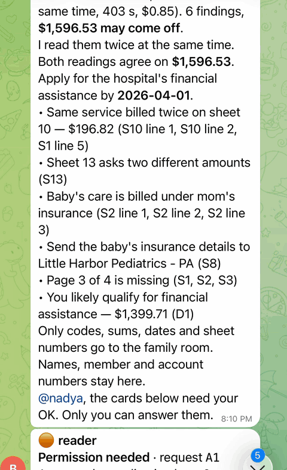
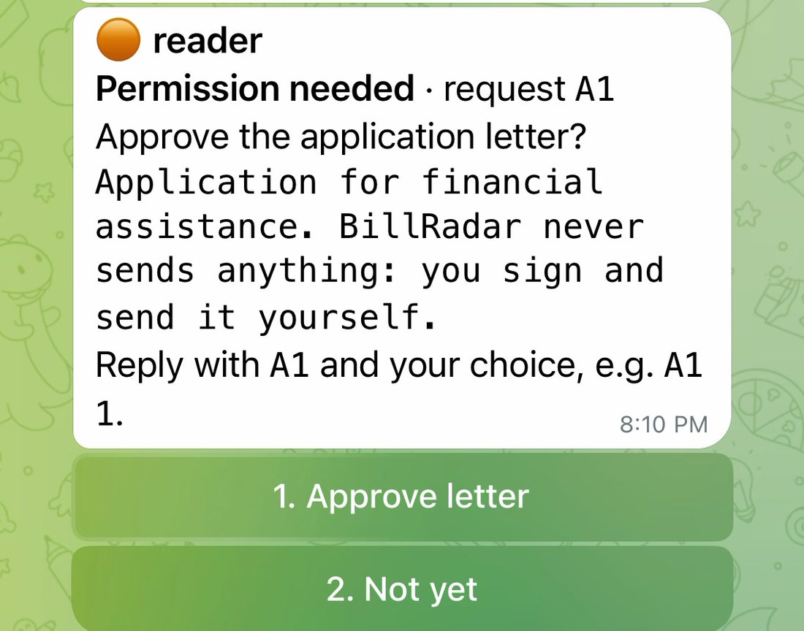
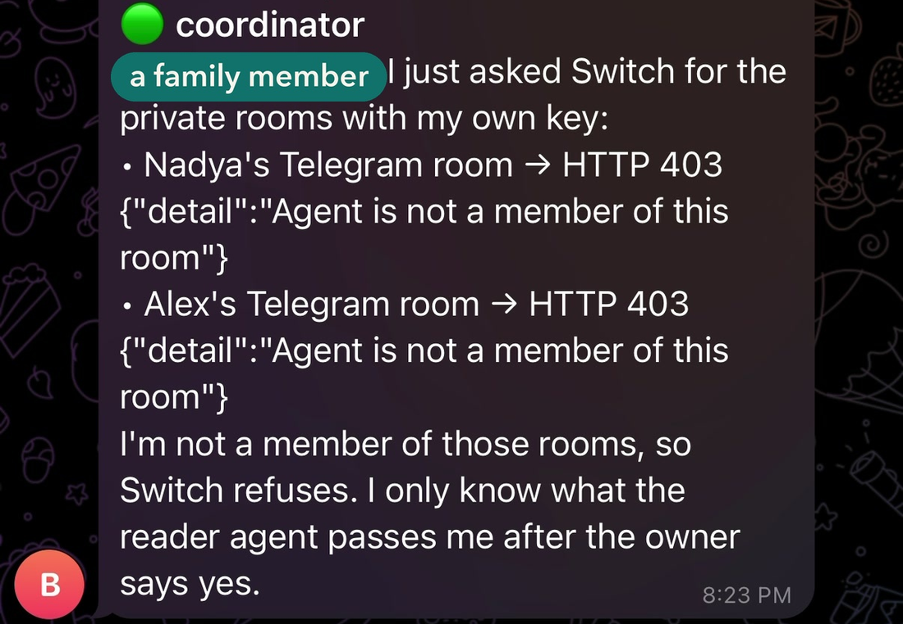
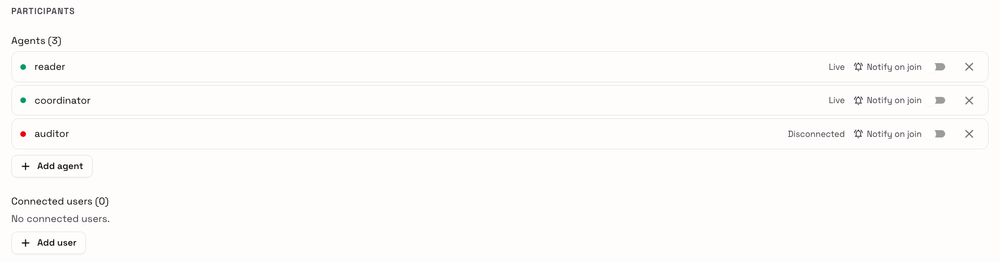
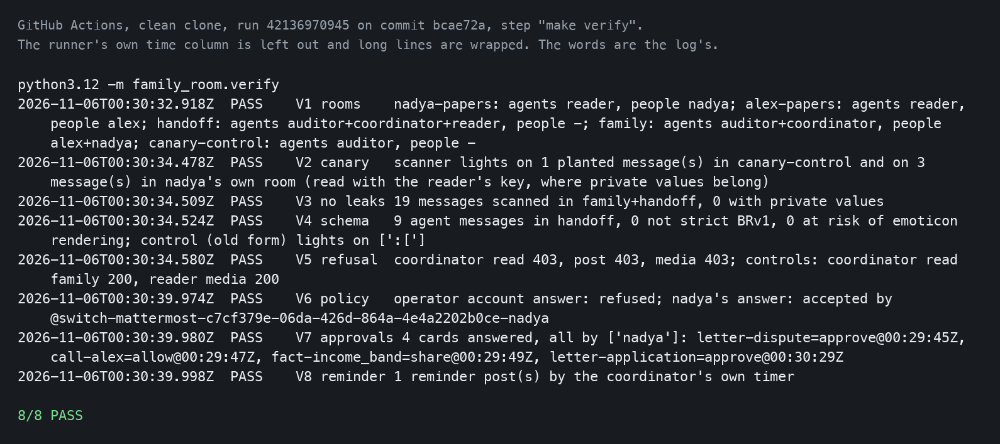
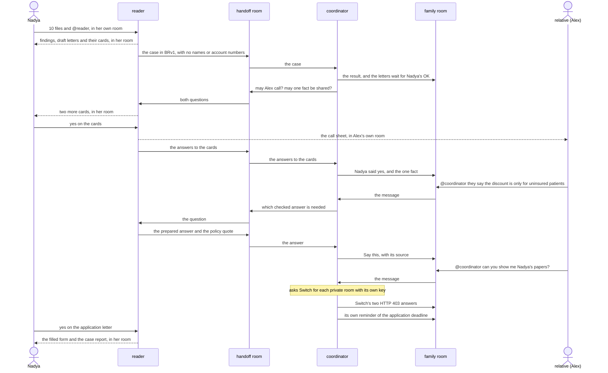

# BillRadar Family Room

10 of 10 live readings at $1,596.53 · 0 wrong sums, 0 false findings · clean clone: 8/8 checks in 177 s · 403 tests pass

[](https://github.com/NadyKor15/billradar-family-room/actions/workflows/clean-clone.yml)

Built on [Switch](https://github.com/sandbox-quantum/switch).

Flip the Switch, track 02: Best Personal or Creative Workflow.

## For judges at a glance

Two agents help the person who handles a family's hospital bills, in chat. Switch room membership keeps the agent that talks with the family away from the papers.

**Demo video:** https://youtu.be/O1DNY7aAeMs

```
git clone --recurse-submodules https://github.com/NadyKor15/billradar-family-room && cd billradar-family-room
make judge
```

`make judge` needs no API keys (what it does need is in [Run it](#run-it-no-api-keys)). It starts a new stand (a local Switch with Mattermost, the BillRadar engine and both agents), plays the whole story, runs the 8 checks and posts the room template to Switch's validate route, then prints one line:

```
JUDGE PASS: up N s, demo N s, verify 8/8, template valid, total N s
```

On GitHub's clean clone that took 177 seconds: `JUDGE PASS: up 109 s, demo 60 s, verify 8/8, template valid, total 177 s` ([run](https://github.com/NadyKor15/billradar-family-room/actions/runs/42232516214)).

What comes from Switch: room membership enforced with a 403, approval cards only the room's owner can answer, addressing rules that name people, and the same two agents on Mattermost and on Telegram. The two agents reach people only through Switch's API and contain no Mattermost or Telegram client, so without Switch they have no rooms, no membership check and no cards.

`make judge` replays recorded results and calls no model. The numbers below come from live mode, where Meta's models read the pack.

On 10 live readings of the fictional sample pack, the total was $1,596.53 in 10 of 10, with 0 wrong sums or deadlines and 0 false findings ([measured](#live-mode)).

The run filmed for the video is not one of those measured runs. It read the pack twice at the same time, in 403 seconds, for $0.85, and both readings came to $1,596.53. The reading shown lists 6 findings and 2 items marked "worth asking" (shown without a sum); scored against the pack's key, that is all 7 planted errors.

How each judging criterion is met: [the table below the snapshots](#how-it-meets-the-judging-criteria).





A card in Nadya's room. Only she can answer it.



Asked for Nadya's papers, the coordinator tries both private rooms with its own key. Switch answers 403 twice.



The `handoff` room in Switch Gateway: three agents and no people. `auditor` is used only by `make verify`.



`make verify` on a clean clone, from [this GitHub run](https://github.com/NadyKor15/billradar-family-room/actions/runs/42136970945).

### How it meets the judging criteria

| Criterion | Where to see it |
|---|---|
| Use of Switch (30%) | Privacy rests on Switch itself: room membership (the coordinator gets 403 on private rooms), approval cards only the room's owner can answer (the server operator's press is refused), the agents-only handoff room, the media route, and the same two agents on Mattermost and on Telegram. Without Switch each of these would have to be built for every messenger. [What keeps private things private](#what-keeps-private-things-private) · [Would it work without Switch?](#would-it-work-without-switch-no) |
| Technical execution (25%) | `make judge` on a clean clone with no keys: the stand, the story, 8 checks with controls and one PASS line. GitHub runs it on every push (badge above). 403 tests pass and 1 is skipped on GitHub's runner. In live mode Meta's models read the fictional pack: 10 of 10 readings found $1,596.53. [Run it](#run-it-no-api-keys) · [Live mode](#live-mode) |
| Creativity and impact (25%) | In most families one person handles everyone's hospital bills: their own, the kids', the parents', each with its own insurance and deadlines. BillRadar Family Room takes most of that work off them: it reads the bills, finds errors of different kinds, such as double charges, and the financial assistance the hospital's own policy allows, and prepares the letters and the filled-in form. Relatives help with the calls without seeing a single document. The video shows a live Telegram chat between two family members. [What it is](#what-it-is) · [The story in four steps](#the-story-in-four-steps) |
| Presentation (20%) | The video, the short loop and the snapshots above, a table of the steps with the Switch feature and API call for each one, and "Try it yourself as Nadya and Alex". [The workflow, step by step](#the-workflow-step-by-step) · [Try it yourself](#try-it-yourself-as-nadya-and-alex) |

## Would it work without Switch? No.

Take Switch away and the two agents have nowhere to read or post: `reader.py` and `coordinator.py` reach people only through Switch's API and hold no Mattermost or Telegram client. Each row below is a Switch feature the story depends on, the code that uses it, and the check that shows it working. V1 to V8 are the checks of [`make verify`](#make-verify), which `make judge` runs on GitHub at every push to main.

| Switch feature | What it does in Family Room | Code | Proof |
|---|---|---|---|
| Room membership | The coordinator is not a member of any private room. When it asks for one with its own key, Switch refuses the read, the post and the media with 403. | `seed.py` creates the rooms and their members; `coordinator.py` `try_private()` | V1: each room holds exactly the agents and people it should, by Switch's room records. V5: 403 on all three, and the controls get 200 |
| Approval cards | The letters, the one fact to share and "Let Alex talk to billing for you?" wait as cards in Nadya's own room. Switch keeps the outcome: who answered, what, and when. | `reader.py` `card()` and `answered()`; `switch.py` `open_card()` and `outcomes()` | V7: every answered card was answered by Nadya, each with its time |
| Addressing rules that name people | The reader answers only the owner of each private room, and the coordinator in `handoff`. The coordinator answers the family in `family`, and the reader in `handoff`. | `seed.py`: `PUT /gateway/agents/{id}/addressing-policy` | V6: on a card in Nadya's room, the server operator's answer is refused and Nadya's answer is accepted |
| Switch's agent protocol | Both agents are registered as `custom` with `connection_model: always_on`. Each keeps one SSE stream open for events and makes plain HTTP calls to act. | `seed.py` registers them; `switch.py` `Agent.run_stream()` and `op()` | `make demo` posts nothing until Switch's room records show both agents live, then waits for each answer. V8: the coordinator posted its reminder from its own timer, with nobody asking |
| Handoff between agents | The reader sends the case, without names or account numbers, to the coordinator in `handoff`, a room with agents and no people. The coordinator's questions go back the same way. | `handoff.py`; `switch.py` `send_to()`: `connect_to_room`, then `send_targeted_message` | V1: `handoff` holds three agents and no people. V3: 0 private values there. V4: every agent message in it is strict BRv1 |
| Room template, checked by Switch | The five rooms and their members in Switch's template format. Switch's validate route checks the YAML and the top-level keys; a test keeps the rooms the same as in `seed.py`. | `deploy/family-room.template.yaml`, `template_check.py`, `tests/test_template_check.py` | `make template-check`, part of `make judge`: `ok: true`, 0 errors, 0 warnings, and the broken copy refused with `invalid_yaml`. Also on a stand on 2026-11-06 |
| Mattermost and Telegram bridges | The same two agents work in Mattermost and in Telegram through one Switch. Their code is the same on both; `wire` points them at the Telegram rooms. | `deploy/switch-0.31.0/` (Mattermost); `telegram.py` `connect`, `wire`, `probe` | Mattermost: all eight `make verify` checks run there. Telegram, live on 2026-11-06: the coordinator got 403 and the reader 200 on both private Telegram rooms |
| Gateway identities | Each family member's Mattermost account, and each Telegram user named on `wire`, is linked to a Switch user, so the addressing rules can name Nadya and Alex. | `seed.py`: `POST /gateway/collaborations/{bridge}/identities`; `telegram.py` `wire()` | V6: the rule that names Nadya's linked identity accepts her answer and refuses the operator's |

Checked live: in the Telegram chat on 2026-11-06 (UTC), a relative asked the coordinator for Nadya's papers. The coordinator asked Switch for both private Telegram rooms with its own key, and Switch answered 403 twice, "Agent is not a member of this room" ([snapshot](docs/img/http-403.png)).

## What it is

For the person who handles a family's hospital bills, and the relatives who sometimes help. That person keeps track of everyone's bills, insurance plans, deadlines and calls to the hospital. When relatives help, letters and photos of bills start going around in chats, and those hold names, account numbers and diagnoses.

Here one agent reads the private papers in that person's own room, and a second agent runs the shared family room. **Switch room membership is what keeps the second agent away from the papers**: when it asks for them, Switch answers 403.

Built for Flip the Switch (track 02, Best Personal or Creative Workflow) on Switch 0.31.0, with the bundled Mattermost and with Telegram. The bills in this repository are fictional; no real medical data appears anywhere.

It runs in two modes. By default neither agent calls a language model: the coordinator is Python rules, and the reader recognizes BillRadar's fictional sample packs and replays the engine's recorded results. With `LIVE=1` (see [Live mode](#live-mode)) the reader reads those same fictional packs with the engine's models, and the coordinator asks a model which of the reader's checked answers fits what a relative reports. Files outside those packs reach no model in either mode.

## The story in four steps

1. In the demo, Nadya handles her family's hospital bills. She sends 10 files of hospital papers to her own room. The reader reports 7 findings: $1,596.53 may come off. (This is the replayed reading; the live reading in the video lists 6 findings and 2 items worth asking.)
2. The reader passes the case to the coordinator without names or account numbers. The family room gets only the result.
3. In her own room, Nadya answers cards that only she can answer: the letters, one fact to share, and whether a relative may call the hospital. After her yes on the application letter, the hospital's form filled in from the case and the case report come to her room as PDFs. She signs and sends the form herself.
4. On hold with billing, the relative (Alex in the demo) reports what billing says, and the hospital's own policy line comes back.

After that the coordinator posts its own deadline reminder, and `make verify` checks that nothing private reached the family room.



All of these messages go through Switch.

## Run it (no API keys)

```
git clone --recurse-submodules https://github.com/NadyKor15/billradar-family-room && cd billradar-family-room
make judge    # make up, make demo, make verify and make template-check, ending in one line
make test     # 404 tests, no stand needed; the ones that use the engine skip until `make engine` has run
make wipe     # stop everything and drop the data
```

`make judge` takes out any live settings and keys it finds in the environment before each step. It stops at the first failure, with the step's name and the end of its output, and leaves the stand up so you can look at it. It clears nothing: if a stand is already there, it says `make wipe first`. After a pass the stand also stays up, so you can open it right away; `make down` stops it and `make wipe` removes it. On GitHub's runner, starting with no images, `make judge` takes about 3 minutes and `make test` about 3 more.

The same steps one at a time:

```
make up              # Switch 0.31.0 + Mattermost, the BillRadar engine (pinned), public policy sources, seed, both agents
make demo            # the story above, ≈60 s
make verify          # 8 checks, ends with "8/8 PASS"; each refusal check has a control that has to succeed
make template-check  # posts the room template to Switch's validate route (see Room template)
make down            # stop everything (make wipe also drops the data)
```

GitHub runs `make judge` and `make test` on a clean clone at every push to main (`.github/workflows/clean-clone.yml`), with no keys.

Needs Docker with Compose v2 (`docker compose`, with the daemon running), Python 3.12 as `python3.12` on your PATH (on Ubuntu, also the `python3.12-venv` package), make, git, curl, openssl and network access. Clone with git: GitHub's Download ZIP leaves out the engine submodule. `make up` pulls the images and downloads 14 public documents (13 policy sources and one blank hospital form), and it stops if a download fails. GitHub's check runs on Ubuntu 24.04, x86_64. The Mattermost image is amd64 only, so Apple Silicon runs it under emulation. Everything binds to 127.0.0.1 (ports: 38000 Switch API, 38030 Switch Gateway, 38065 Mattermost, 38432 Postgres). `make demo` plays Nadya and Alex through Mattermost's API. Open http://localhost:38065 to watch; the demo people are `nadya` and `alex`, and their passwords are in `state/people.json` (`python3 -c "import json; print(json.load(open('state/people.json'))['nadya']['password'])"` prints Nadya's). Switch Gateway is at http://localhost:38030; its login is `GATEWAY_ADMIN_EMAIL` and `GATEWAY_ADMIN_PASSWORD` in `deploy/.env`.

## Try it yourself as Nadya and Alex

This is the story `make demo` runs, done by hand, in default mode with no keys. Run `make up` and not `make demo`; if the demo has already run, `make wipe && make up` gives a clean stand.

Open http://localhost:38065 in two windows, one of them private so each keeps its own login. Log in as `nadya` in one and as `alex` in the other, with the passwords from `state/people.json`.

1. As Nadya, in the channel `nadya-papers`, attach the 10 papers from `vendor/billradar-meta/eval/packs/work/brs1-birth-all-errors/` (the `.pdf` and `.jpg` files at the top of that folder) and write `@reader here are the papers from the hospital`. The reader answers there that $1,596.53 may come off, and `family` gets the result. Five cards appear in her room. Answer a card only when a step says so: tap it, or type its code and the option's number, such as `A2 1`.
2. Approve the dispute letter. `family` says she approved it.
3. On "Let Alex talk to billing for you?", answer yes. The call sheet appears in `alex-papers`, and `family` says she said yes.
4. On "Share one fact with the family room?", share it. `family` gets the income band and no income amount.
5. As Alex, in `family`, write `@coordinator they say the discount is only for uninsured patients`. An answer with "Say this:" comes back with its source.
6. Still as Alex, write `@coordinator can you show me Nadya's papers?`. The coordinator tries the private rooms with its own key and shows Switch's HTTP 403 for each.
7. The coordinator's reminder appears in `family` 45 seconds after the case arrived, so it may already be there. If you approve the application letter before it appears, the reminder is not posted and V8 (see [make verify](#make-verify)) has nothing to find.
8. As Nadya, approve the application letter. The filled form and the case report arrive in `nadya-papers`.

Then `make verify` runs the 8 checks on what you did.

## Two agents, different jobs

| | `@reader` | `@coordinator` |
|---|---|---|
| Member of | each person's private room, the agents-only `handoff` room | `family`, `handoff` |
| Holds | the photos, the BillRadar case, names and account numbers | codes, cents, dates, sheet and line numbers, usernames, prepared call answers and public policy quotes |
| Talks to | the owner of each private room; the coordinator in `handoff` | the family in `family`; the reader in `handoff` |
| Runs | in the engine's environment, BillRadar over MCP stdio | plain Python, stdlib only, its own API key and nothing else (with `LIVE=1`, also the model key) |

Both are custom agents on the Switch agent protocol (`connection_model: always_on`): one SSE stream down, HTTP up. `reader.py` and `coordinator.py` reach people only through Switch's API and contain no Mattermost or Telegram client, so moving to Telegram changes only room ids in their state files. Rooms, the membership check, approval cards and addressing rules all come from Switch; without it each would have to be written per platform.

## The workflow, step by step

| # | Story step | What the family sees | Switch primitive | File | Call |
|---|---|---|---|---|---|
| 1 | 1 | Nadya posts 10 photos and PDFs with "@reader" in her own room | attachments on an addressed message; media route | `reader.py` `papers()` | SSE `message.attachments[]` → `GET /agents/{id}/rooms/{room}/media?mxc=…` |
| 2 | 1 | With `LIVE=1`, up to three lines say which model is at work: SAM 3.1, Muse Spark, Muse Wonder | agent message | `progress.py` | `POST /agents/{id}/message` |
| 3 | 1 | Reader answers in her room: 7 findings in the replayed reading, $1,596.53 may come off | agent message | `reader.py` | `POST /agents/{id}/message` |
| 4 | 2 | Reader hands a de-identified case to the coordinator | agent-to-agent addressed message in an agents-only room | `handoff.py`, `reader.py` | `connect_to_room` + `send_targeted_message` |
| 5 | 2 | Coordinator posts the result in the family room: the letters wait for Nadya's OK, and a relative is asked about only through her | @-addressing people | `coordinator.py` `case_posted()` | `POST /agents/{id}/message` |
| 6 | 3 | Letters wait for Nadya's OK as cards in **her** room | approval cards; addressing policy decides who may answer | `reader.py` `card()` | `POST /agent-sessions/{sid}/approvals`, `GET /agent-sessions/approvals/outcomes` |
| 7 | 3 | "Share one fact with the family room?" (income band, no income amount) | approval card as consent | `reader.py` `request()` | same |
| 8 | 3 | "Let Alex talk to billing for you?" → the call sheet appears in Alex's own room | consent card; the reader moves private data only between private rooms | `reader.py` `answered()` | same + `POST /agents/{id}/message` |
| 9 | 4 | On hold, Alex writes "@coordinator they say the discount is only for uninsured patients" → the hospital's own policy line comes back | round trip coordinator → reader → coordinator in `handoff` | `coordinator.py` `from_person()` | `send_targeted_message` both ways |
| 10 | after | "Show me Nadya's papers" → the coordinator tries with its own key, Switch says 403 | room membership enforced by the server | `coordinator.py` `try_private()` | `POST /agents/{id}/ops/read_context` |
| 11 | after | "⏰ Reminder: the financial assistance application is due 2026-04-01 and isn't approved yet" | Switch has no scheduler, so the coordinator keeps its own clock | `coordinator.py` `remind()` | `POST /agents/{id}/message` |
| 12 | 3 | After her yes on the application letter, the filled form and the case report arrive as PDFs in **her** room and no other. The sample's form carries the stamp "SAMPLE - FICTIONAL DATA". BillRadar sends nothing: she signs the form and sends it herself | a file sent by an agent to a room | `reader.py` `send_application_files()` | `POST /agents/{id}/rooms/{room}/media` |

Telegram sends an album as separate messages: the reader takes the owner's files posted in the room in the 2 minutes before the @reader message; if nothing is left in that window, it asks for them again. The reader says "I read N files" (in the sample pack, 7 photos show 14 sheets and 3 files are PDFs, so findings cite "sheet 13" or "file 3").

Seeding (`seed.py`) uses the Gateway: `POST /gateway/users`, `POST /gateway/collaborations/{bridge}/identities` (links each Mattermost account to a Switch user), `POST /gateway/rooms`, `PUT /gateway/agents/{id}/addressing-policy`.

## What keeps private things private

- **Membership (Switch).** The coordinator is not a member of any private room, so `read_context`, the media route and posting there all return 403 (`make verify` V5, with controls that return 200).
- **Addressing policy (Switch).** The reader answers only the owner of each private room. A card in Nadya's room can be answered only by Nadya; the server operator's account, which Switch's setup puts in every channel, is refused (V6). The rules name people and never use Switch's `owner` subject: `seed.py` registers the agents with the deployment token, so their owner in Switch is a service record, Agent Bootstrap, and no person.
- **Strict handoff schema and a PII gate (our code).** Every handoff message is `BRv1 ` plus one JSON object in an inline-code span (Mattermost renders `:[` in plain JSON as an emoticon; the old form without backticks still decodes): enums, integer cents, ISO dates, sheet and line references, letter kinds, source refs, and a family member's username in call requests. The only sentences are BillRadar's prepared call answers and quotes from public policies, and each passes an on-machine gate built from the case's own private values. Unknown keys are refused on both ends (`tests/test_boundary.py`).
- **Threat note.** The agent that talks with the family never holds a document and is refused the private rooms by Switch, so nothing typed in the family chat can pull a document out of it. By default it runs no model. With `LIVE=1` a model picks an answer's id for it and nothing the model writes is posted (`tests/test_chooser.py`). What Switch does not filter is what a member agent chooses to post; that part is the reader's code, tested above and checked live by V3.

## make verify

| | Check | Control that must succeed |
|---|---|---|
| V1 | each room holds exactly the agents and people it should (Switch's room records) | none: exact match, fails on any extra agent or person (the server operator's accounts are not counted) |
| V2 | the scanner lights on a planted canary and on the owner's own room | itself |
| V3 | 0 private values, account-like numbers or media handles in `family` and `handoff` | V2 |
| V4 | every agent message in `handoff` is strict BRv1 and none can render as an emoticon | the same scan lights on a synthetic old-form message |
| V5 | coordinator: private room read, post, media → 403 | coordinator reads `family` → 200; reader fetches the media → 200 |
| V6 | operator account answers a card in Nadya's room → refused | Nadya answers the same card → accepted |
| V7 | Switch's outcome records, as the reader saved them to `state/approvals.jsonl`: who approved which card, and when | — |
| V8 | the coordinator's own reminder was posted | — |

To see V3 fail, log in as `alex`, post `1234567` in `family`, and run `make verify` again: any run of 7 or more digits counts as account-like. `make wipe && make up` gives a clean stand.

`make verify` uses a third agent, `auditor`. It is a member of `family`, `handoff` and its own `canary-control` room, nobody can address it, and it scans the shared rooms with `read_context`. It posts only the planted canary, and only in `canary-control`.

## Room template

`deploy/family-room.template.yaml` describes the same five rooms and members as `seed.py`, in Switch's template format; `tests/test_template_check.py` fails if the two differ. `make template-check` posts it to `POST /gateway/templates/validate` on the running stand, which stores nothing, and passes only on `ok: true` with 0 errors. That route checks the YAML and the top-level keys and does not look inside the rooms; the test against `seed.py` is what checks the rooms. It also posts the same document with a break added at the end. If Switch does not refuse that copy, the check fails as blind.

On a stand on 2026-11-06 the template came back with `ok: true`, 0 errors and 0 warnings, and the broken copy with `ok: false` and `invalid_yaml`.

Rooms here are created by `seed.py`. Creating the rooms from the template has not been tried.

## What is reused and what is new

| Part | When it was made | Evidence |
|---|---|---|
| BillRadar engine (`vendor/billradar-meta`, git submodule pinned at `b20aeb9`, same author) | Before this repository, for another project. Its files are unchanged at the pinned commit. Used over its MCP stdio server, and as a library for a live reading and the filled form | Its own public history: 10 commits, 2026-11-03 13:20 to 22:08 (UTC−5). The hacking window opened at 13:31 UTC−5 that day; the 2 later commits touch docs, one template and one test. It contains no Switch code |
| Switch's Compose file `deploy/switch-0.31.0/standalone-docker-compose.yml` | Published by Switch, unchanged | `LICENSE-switch` (Apache 2.0 with the Commons Clause, as Switch publishes it) |
| Everything else: both agents, the handoff schema and PII gate, seed, demo, verify, the stand scripts, this README | During the hackathon window, Nov 4 to 7, 2026, in IST (it opened at 13:31 UTC−5 on Nov 3) | This repository's git history, first commit 2026-11-04 19:35 (UTC−5) |

Without keys the engine runs only its fictional sample packs and says so (REPLAYED); the reader recognizes a pack by the sha256 of the posted files, and part of a pack is enough: the whole pack is replayed. With `LIVE=1` the same rule decides what may go to a model, and only the files that were posted are read. The sample hospital, Seaside Regional, is fictional; its policy text is the public Financial Assistance Policy of Memorial Healthcare System (`memorial-2026-05`). The sample's "today" is 2026-03-02, so the deadline, 2026-04-01 (12 months after the last insurance payment on the sheets), is still ahead.

## AI tools used to build it

The code was written with Claude Code as a coding assistant. Since the GitHub Actions workflow was added, every push to main is checked by the tests and by `make judge` on a clean clone on GitHub. At runtime the project calls only Meta's models, and only in live mode.

## Live mode

There are two modes. By default the reader replays the engine's recorded result for a recognized fictional pack, and neither agent calls a model. With `LIVE=1` and a Meta Model API key, the reader reads that pack with the engine's models: SAM 3.1 finds the sheets, Muse Spark reads them, Muse Wonder reviews the result. The coordinator asks Muse Spark which checked answer fits.

A model's reading varies from run to run, so the reader reads the pack twice at the same time and shows the reading that found more money, then more items. A line in the owner's room says whether the two agree and gives both totals if they differ. If one reading stops, the line says the papers were read once.

`deploy/agents.sh` passes each agent only its own variables from the table below. Without `LIVE=1` neither agent gets any of them, even if the shell has them. `deploy/agents.sh start` refuses `LIVE=1` with no key.

A live run needs a stand that is up (`make up`), a Meta Model API key (dev.meta.ai, API keys) and, for sheets with no recorded answer, Muse Glimmer on your own computer: llama.cpp's `llama-server`, about 20 GB of weights in `~/Models/Muse-Glimmer-30B-GGUF` and about 32 GB of free memory. The recorded Glimmer answers matched on the Mac that made them and not on a second Mac, so on a computer without Glimmer expect the reading to stop at the first sheet with no matching recording (`Live reading stopped`); nothing falls back to the replay. `make judge` and the default mode need none of this.

```
export MODEL_API_KEY=...        # from your own secret store; it is never written to a file here
LIVE=1 REMINDER_AFTER_S=45 deploy/agents.sh restart   # 45 s, as make up sets it; agents.sh alone uses 60
LIVE=1 make demo                # waits up to an hour for the reader's answer
make verify
.venv-engine/bin/python -m family_room.live_eval    # one JSON line about the last live reading
```

| Variable | Who gets it | What it does | Default |
|---|---|---|---|
| `LIVE` | both | `1` turns live mode on | off |
| `MODEL_API_KEY` | both | the key; reaches a process only through its environment | none |
| `LIVE_READINGS` | reader | how many readings of the same papers run at once | 2 |
| `LIVE_SHARED_GLIMMER` | reader | `1` lets every reading use Muse Glimmer. Each one still starts `BILLRADAR_LLAMA_SERVER`, so sharing one Muse Glimmer on `BILLRADAR_GLIMMER_PORT` needs a stand-in for that program. Otherwise only the first reading may start one | off |
| `LIVE_SPEND_CAP_USD` | reader | daily ceiling, passed to the reading as `BILLRADAR_DAILY_SPEND_USD`; must be above 0 | 15 |
| `META_SPEND_CAP_USD` | reader | the engine's ceiling over all days | 40 |
| `LIVE_READ_TIMEOUT_S` | reader | how long one reading may run before it is stopped | 3600 |
| `BILLRADAR_LLAMA_SERVER`, `BILLRADAR_GLIMMER_DIR` | reader | where llama-server and the Muse Glimmer weights are, if not on `PATH` and in `~/Models/Muse-Glimmer-30B-GGUF` | |
| `BILLRADAR_SECOND_READ` | reader | `0` turns off the engine's second read | on |
| `BILLRADAR_WONDER_REVIEW` | reader | `0` turns off Muse Wonder's review | on |
| `CHOOSER_MAX_CALLS` | coordinator | model calls per process, then word overlap only | 50 |
| `CHOOSER_TIMEOUT_S` | coordinator | seconds for one model call, then word overlap | 15 |
| `READER_WAIT_S` | `make demo` | how long it waits for the reader's answer | 60, or 3600 with `LIVE=1` |

**What goes to a model.** A live reading starts only when the sha256 of every posted file matches a paper of a single fictional pack. Any other file gets the same refusal as without `LIVE=1`, and no reading starts.

- **The reader** starts a child process for each reading (`family_room/live_read.py`) and gives it the pack's name and the sha256 list, never the bytes. The child reads only the pack's own files on that list, checks that the pack says `"fictional": true`, and refuses otherwise, so a file from outside the pack cannot get to a model. It runs the engine's `pipeline.run` with the pack's own profile and date, in the engine's private mode: a blurred copy of each photo goes to SAM 3.1, the closed sheets and PDF pages to Muse Spark, and the findings and letters to Muse Wonder. A new pack without a profile is not read.
- **Progress lines.** The room would otherwise stay silent for minutes, so the reader posts up to three lines, each once, as the engine's journal shows the stage: "Finding the sheets on your photos with SAM 3.1.", "Private lines are closed on this computer. Muse Spark is reading the closed sheets." and "Muse Wonder is checking the findings against the sheets." (`family_room/progress.py`). The journal holds names, counts and prices of calls, and no content.
- **The closing step** reads each sheet on this computer with Muse Glimmer. On this pack it first looks for a recorded answer to the same picture. The recordings match byte for byte only where the pictures come out exactly the same: on the Mac that made them all of them matched, and on another Mac with the same package versions they did not. A sheet with no recording needs Muse Glimmer itself: llama-server, the weights and about 32 GB of free memory. Without those the reading stops at the first such sheet and says so. What Glimmer answers is kept in `~/.cache/billradar-family-room/`, so on a new computer the first reading is the slow one, and after that only a picture it has not seen goes to Glimmer. SAM 3.1, Muse Spark and Muse Wonder are called on every reading.
- **Reading rules.** `family_room/reading_fixes.py` applies four fixed rules to a model's reading, after the reading and before the engine's checks, in live mode only. A PDF bill whose provider was read as a person ("LAST, FIRST") is the hospital's bill when its first printed lines name the hospital and no practice. On a summary statement, a line that says "total" and repeats the sheet's total charges to the cent is not a service. When such a sheet is left with no lines but its balance and total charges were read, two reads that differ only in whether it has no lines or at most 2 lines raise no doubt about its money. A line with no date on a sheet that covers one day takes that day. On an itemized bill, when one of two identical lines holds the sheet's whole balance as its patient share and no other line has a share, that amount is the balance. No rule writes a sum, but a rule can move the total, up or down, by changing what the engine's checks count. The checks still work out every sum, and the engine's verifier, which sees the corrected reading, has the last word. A rule that fires leaves a line in the reading's `problems`. The engine's own files stay unchanged at the pinned commit, so these rules live in this repository.
- **The marked sheet** comes after the owner has received the message and the cards, and after the handoff has gone out. It is made only for the reading that is shown: a short separate child process (`family_room/live_marks.py`) calls the engine's own `highlight.attach` on that finished case, one SAM 3.1 call per mark on the covered sheet, through the same spend ceiling. The reading that is not shown pays for no mark. A mark exists only for a finding with a sum printed on a photographed sheet; PDF pages and findings without a sum on a sheet (in the sample pack, the $1,399.71 financial assistance finding) get none. Where the device cannot find the row, there is no mark and nothing is said about it. Each mark SAM 3.1 confirmed is posted as one JPEG in the owner's own room, then one line: "BillRadar marks the exact line on the photo: code finds the row on this device and SAM 3.1 confirms it on the covered sheet." A mark only the row finder stands behind is not posted. The picture holds the sheet as photographed, so it goes nowhere else, and the handoff message is unchanged. A failure here is logged and loses nothing that was already sent.
- **The MCP server** has no key and no live switch in either mode. It only reads finished cases.
- **The coordinator** sends what the relative wrote and the numbered list of things billing often says (the case's `they_say` strings) in one stdlib HTTP call to the same endpoint and model as the engine's reader. Long digit runs, media handles, phone numbers and US dates are dropped first. A name someone typed has no fixed pattern to filter on, so it does go through.

`python -m family_room.telegram wire` and `unwire` restart the agents with the caller's environment, so run them with the same variables to stay live, and with `REMINDER_AFTER_S=45` to keep the 45-second reminder.

**What the coordinator's model can and cannot do.** It can name one id from the list, or none. Its reply is parsed for that one field, and anything else counts as a failed call and falls back to word overlap. An id that is not in the list counts as none. It cannot post a word: the sentence in the family room is the reader's checked answer with its quote, built by code. "Show me Nadya's papers" is handled before the model is asked, so the 403 does not depend on it. Each call adds a line to `state/model_calls.jsonl`: time, model, status, chosen id, seconds, and no message text. These calls are not in the engine's spend book; `CHOOSER_MAX_CALLS` is their limit.

**When something fails.** When no reading finishes, the room hears "Live reading stopped" with the reason, the cap and a missing Muse Glimmer included, and the family room gets nothing. The reader never falls back to the recording and never claims a live result it did not get. Papers posted while a live reading runs are refused. A timeout stops the child and everything it started, and only those. The child stops itself if the reader goes away.

**What a live run leaves.** `state/live_runs.jsonl` has one line per run with both readings' totals, the run's cost, seconds and models, and the list of problems for each finished reading, so a partial failure is visible. `state/engine-live.log` has the child's stderr, and the models' raw answers go to `state/live-recordings/`. The finished case goes to `runs/` in the engine's folder, which its git ignores, so the submodule stays clean (`tests/test_live_dryrun.py` checks `git status` on a clone of it).

**Measured on `brs1-birth-all-errors`** (`family_room/live_eval.py`, scored as the engine's `scripts/eval_run.py` scores its own path): 5 runs of two readings at once, 10 readings. They ran with `LIVE_SHARED_GLIMMER=1`, Muse Glimmer on a second Mac through a tunnel, and its answers kept from earlier readings, so a first reading on a new computer takes longer.

| | 10 live readings |
|---|---|
| Total $1,596.53 | 10 of 10 |
| Wrong sums or deadlines | 0 |
| False findings | 0 |
| Planted findings found | 7 of 7 in 2 readings, 6 of 7 in 8 |
| A prepared answer to "they say the discount is only for uninsured patients" | 10 of 10 |
| Cost per run, both readings, before the marked sheet | $0.71 to $0.85 |
| Time per run | 310 to 366 s |

In those 8 readings the seventh finding, newborn care filed on the mother's member ID, came back under "worth asking", and the score does not count it as found.

## Reproducing: what to know

- If something fails: `make status` shows the containers and the agents, `logs/reader.log` and `logs/coordinator.log` hold the agents' output, and `TAIL=80 deploy/stand.sh logs` shows the last 80 lines of each container's log.
- Switch is pinned to 0.31.0 (`SWITCH_VERSION` in `deploy/.env`). Other versions are untested.
- `make up` installs the engine with pypdf below 7: pypdf 7.0.0, released on 2026-11-06, removed a call the engine's form filler makes.
- The Mattermost image is amd64 only. On Apple Silicon, Docker runs it under emulation, so the first start is slow. `make up` waits up to 4 minutes for Switch's setup to finish and goes on even if it has not. If the seed step (`family_room.seed`) then fails with a Python error, Switch's setup may not have finished: check `docker logs nadflip-setup-1`, then run `make wipe` and `make judge` again.
- `deploy/stand.sh init-env` (run by `make up`) writes `deploy/.env` with fresh secrets, including `CONTROLLER_TOKEN_SECRET`. The file is created with mode 0600 and stays on your machine.
- `seed.py` links each Mattermost account to a Switch user before the agents start (`POST /gateway/collaborations/{bridge}/identities`). Addressing rules name people by that link, so the link has to exist first.
- A newly registered Switch agent answers only its owner (Switch docs, identity-and-access, "Precedence"). `seed.py` sets the rules for both agents: the reader answers the owner of each private room and the coordinator in `handoff`; the coordinator answers the family in `family` and the reader in `handoff`.

## Telegram

The same agents also run in Telegram, through the same Switch, with no public address (the bridge uses long polling). `make up` starts Mattermost only; Telegram is a manual step, checked live on 2026-11-05. Run the commands below from the repository root, with the stand up.

1. Create a bot with @BotFather and turn Group Privacy off before adding it to a group.
2. Put `{"bot_token": "...", "bot_username": "..."}` in a file and run `python3.12 -m family_room.telegram connect < that-file`. The token is not printed or logged.
3. Create the groups and add the bot to each: one for the person handling the bills, one for the family, and, if you want the call sheet on the relative's phone, one for the relative. Each person needs a Telegram username and writes one message in each of their groups, so Switch sees the rooms and the people.
4. `python3.12 -m family_room.telegram status` lists room ids and Telegram user ids. Then `python3.12 -m family_room.telegram wire PAPERS_ROOM FAMILY_ROOM OWNER_ID HELPER_ID [HELPER_ROOM]`. `python3.12 -m family_room.telegram probe` asks Switch about each private group as each agent: the coordinator must get 403 and the reader 200. `unwire` puts the agents back on Mattermost. OWNER_ID is the Telegram user id that `wire` links to the Switch user `nadya`, and HELPER_ID the one it links to `alex`; `-` skips one, so with a single Telegram account pass `-` for HELPER_ID.

The coordinator's 403 and the reader's 200 on both private Telegram rooms were checked live on 2026-11-06.

What is different in Telegram:

- An album arrives as separate messages, and only one of them carries the caption. The reader counts everything the same person sent in the 2 minutes before the "@reader" message as one batch, so a file sent in that window by mistake would join it. A first file older than 2 minutes is left out, so write the "@reader" phrase as the caption of the last file.
- Telegram recompresses images picked from the gallery, and the reader then cannot recognize the sample pack. Send them as files.
- Cards appear as inline buttons in the owner's group.
- The files to send are in `vendor/billradar-meta/eval/packs/work/brs1-birth-all-errors/`.
- One Telegram bot fronts both agents, and Switch still checks room membership per agent.
- `handoff` and `make verify` stay on the Mattermost rooms. The coordinator's 403 probe asks about each person's Telegram group if they have one, and otherwise about their Mattermost room.
- With `HELPER_ROOM` the call sheet goes to the relative's Telegram group. Without it, it goes to their Mattermost room `alex-papers`.

## What we learned about Switch

What we ran into on Switch 0.31.0, how we worked around it, and what would help.

| What we saw | What we did | What would help |
|---|---|---|
| A refused card answer shows up only in Switch's log; the person who pressed sees nothing. | Nothing we can do from an agent. | A reply to the person whose press was refused. |
| In Mattermost, Switch adds "Nobody here is linked to this agent's owner…" to each card, because the agents' owner is the service record Agent Bootstrap. Telegram cards don't carry it. | The reader names the room's owner in its own text. | A way to hide the line when the addressing rule already names the person. |
| Switch's setup puts the server operator's Mattermost accounts in every channel, including private rooms and `handoff`. | `make verify` V6 checks that the operator's press on a card in Nadya's room is refused. | Private rooms without the operator. |
| A Telegram album arrives as separate messages, and only one of them carries the caption. | The reader takes the same person's files from the 2 minutes before the "@reader" message. | Albums delivered as one event. |
| Telegram's bridge can log "Timed out" or "couldn't be relayed" for a message or file that did arrive, and after such a timeout a card's button may answer that the "control does not belong to this card". | Listed here. | A delivery status that tells a delay from a failure. |
| There is no scheduler. | The coordinator keeps its own timer for reminders. | A scheduler for reminders. |
| The bundled Mattermost image is amd64 only, so it runs slowly on Apple Silicon. | We ran the stand on it anyway. | An arm64 image. |

## Known limits

- Only BillRadar's fictional packs are ever read, in both modes. Reading a family's own papers is not built here.
- Both agents run as one OS user, and each reads its own key from `state/` by convention. A real deployment would run them under separate users.
- Cases and the reminder timer live in memory: restarting an agent forgets them. In the demo the reminder fires 45 seconds after the case arrives (`REMINDER_AFTER_S`); it does not count down to the date.

## License

This repository's own code is under the MIT License (`LICENSE`). `deploy/switch-0.31.0/` and the submodule `vendor/billradar-meta` keep their own licenses.
